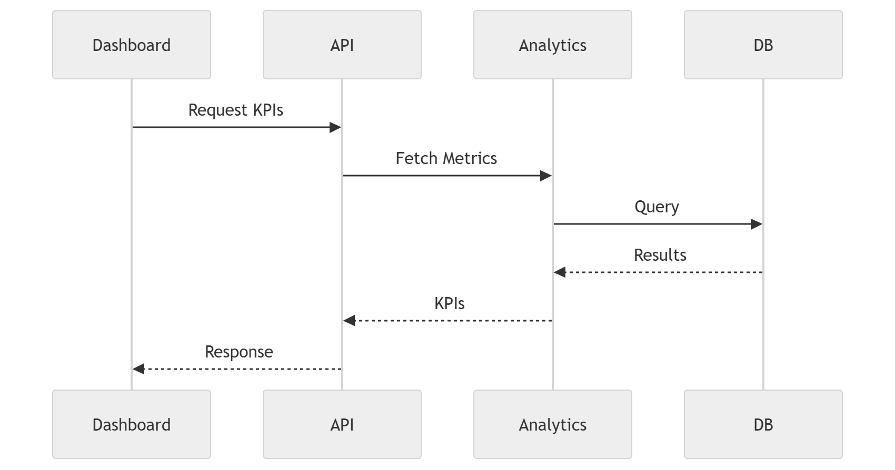

# 44 · Dashboard Request

> **Section:** [Backend & API](../../backend/overview.md) &nbsp;|&nbsp; **Diagram ID:** `44`

## Purpose

Dashboard request lifecycle.

## Description

How a dashboard query flows through gateway, services, cache and warehouse back to the SPA.

## Diagram

## Inputs

- Dashboard query

## Outputs

- Rendered analytics

## Dependencies

- API
- Cache
- Warehouse

## Business Value

Explains dashboard latency and caching behaviour.

## Technical Notes

Cache fronts these reads (38).

## Related Diagrams

- [08 · Dashboard Modules](../01_System_Overview/08_Dashboard_Modules.md)
- [38 · Cache Architecture](../03_Data_Architecture/38_Cache_Architecture.md)
- [39 · Analytics Warehouse](../03_Data_Architecture/39_Analytics_Warehouse.md)
- [45 · Report Generation](../04_Backend/45_Report_Generation.md)

---

### Navigation

⬅ Previous: [43 · Processing Sequence](../04_Backend/43_Processing_Sequence.md)  &nbsp;|&nbsp;  ⬆ [Diagram Index](../../architecture_index.md)  &nbsp;|&nbsp;  ➡ Next: [45 · Report Generation](../04_Backend/45_Report_Generation.md)
