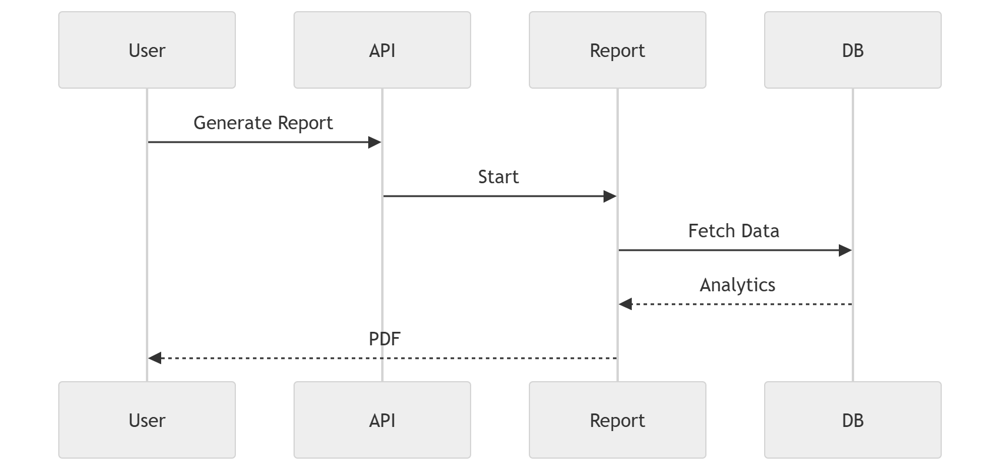

# 45 · Report Generation

> **Section:** [Backend & API](../../backend/overview.md) &nbsp;|&nbsp; **Diagram ID:** `45`

## Purpose

Report generation.

## Description

Scheduled/on-demand report assembly, rendering and delivery (PDF/exports).

## Diagram

## Inputs

- Analytical data

## Outputs

- Reports / exports

## Dependencies

- Reporting service
- Warehouse

## Business Value

Delivers periodic insight to stakeholders automatically.

## Technical Notes

Shares data paths with dashboard requests (44).

## Related Diagrams

- [44 · Dashboard Request](../04_Backend/44_Dashboard_Request.md)
- [25 · Business Intelligence](../02_AI_Pipeline/25_Business_Intelligence.md)
- [39 · Analytics Warehouse](../03_Data_Architecture/39_Analytics_Warehouse.md)

---

### Navigation

⬅ Previous: [44 · Dashboard Request](../04_Backend/44_Dashboard_Request.md)  &nbsp;|&nbsp;  ⬆ [Diagram Index](../../architecture_index.md)  &nbsp;|&nbsp;  ➡ Next: [46 · Event Driven Backend](../04_Backend/46_Event_Driven_Backend.md)
