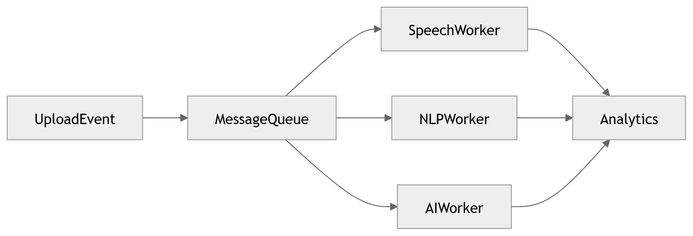

# 46 · Event Driven Backend

> **Section:** [Backend & API](../../backend/overview.md) &nbsp;|&nbsp; **Diagram ID:** `46`

## Purpose

Event-driven backend.

## Description

The asynchronous core: events, topics, consumers and the saga/choreography that decouples services.

## Diagram

## Inputs

- Domain events

## Outputs

- Reactions / state changes

## Dependencies

- Message broker
- Consumers

## Business Value

Scalability and resilience through decoupling.

## Technical Notes

Underlies async paths in service communication (5).

## Related Diagrams

- [05 · Service Communication](../01_System_Overview/05_Service_Communication.md)
- [43 · Processing Sequence](../04_Backend/43_Processing_Sequence.md)
- [47 · Backend Service Dependency](../04_Backend/47_Backend_Service_Dependency.md)
- [04 · Microservice Dependency](../01_System_Overview/04_Microservice_Dependency.md)

---

### Navigation

⬅ Previous: [45 · Report Generation](../04_Backend/45_Report_Generation.md)  &nbsp;|&nbsp;  ⬆ [Diagram Index](../../architecture_index.md)  &nbsp;|&nbsp;  ➡ Next: [47 · Backend Service Dependency](../04_Backend/47_Backend_Service_Dependency.md)
