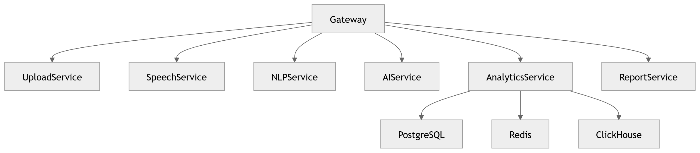

# 47 · Backend Service Dependency

> **Section:** [Backend & API](../../backend/overview.md) &nbsp;|&nbsp; **Diagram ID:** `47`

## Purpose

Backend service dependency map.

## Description

Dependency graph specific to backend (non-AI) services and their datastores.

## Diagram

## Inputs

- Service registry

## Outputs

- Backend dependency graph

## Dependencies

- Backend services

## Business Value

Guides safe change and incident triage in the backend.

## Technical Notes

Backend-scoped counterpart of the microservice map (4).

## Related Diagrams

- [04 · Microservice Dependency](../01_System_Overview/04_Microservice_Dependency.md)
- [46 · Event Driven Backend](../04_Backend/46_Event_Driven_Backend.md)
- [50 · Backend Overview](../04_Backend/50_Backend_Overview.md)
- [05 · Service Communication](../01_System_Overview/05_Service_Communication.md)

---

### Navigation

⬅ Previous: [46 · Event Driven Backend](../04_Backend/46_Event_Driven_Backend.md)  &nbsp;|&nbsp;  ⬆ [Diagram Index](../../architecture_index.md)  &nbsp;|&nbsp;  ➡ Next: [48 · Authentication](../04_Backend/48_Authentication.md)
