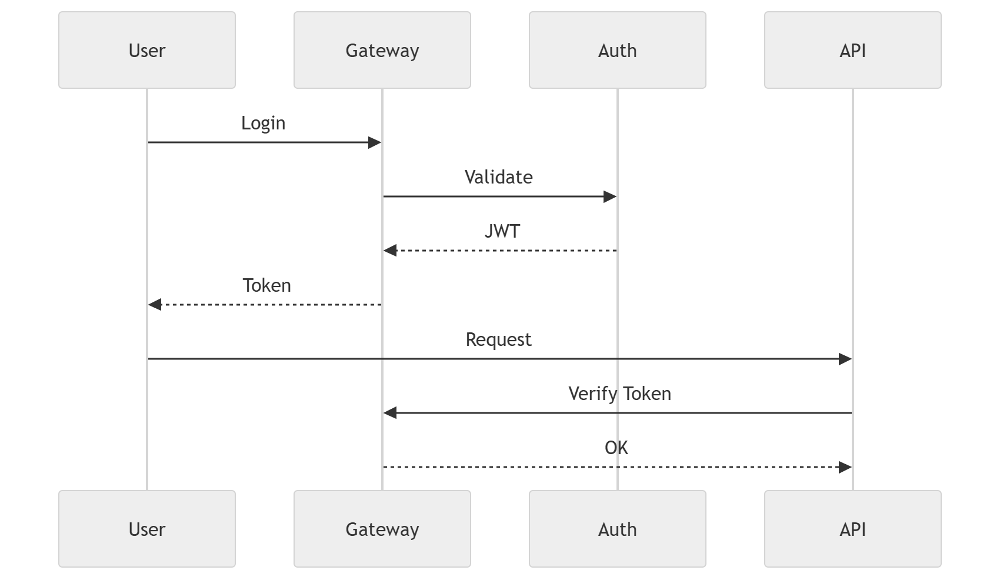

# 48 · Authentication

> **Section:** [Backend & API](../../backend/overview.md) &nbsp;|&nbsp; **Diagram ID:** `48`

## Purpose

Authentication flow.

## Description

End-to-end auth: login, token issuance/refresh, validation at the gateway and propagation to services.

## Diagram

## Inputs

- Credentials / IdP assertions

## Outputs

- Signed tokens / sessions

## Dependencies

- Identity provider
- Gateway

## Business Value

Establishes trusted identity for every request.

## Technical Notes

Pairs with RBAC (49) for authorization.

## Related Diagrams

- [41 · API Gateway](../04_Backend/41_API_Gateway.md)
- [49 · RBAC](../04_Backend/49_RBAC.md)
- [50 · Backend Overview](../04_Backend/50_Backend_Overview.md)

---

### Navigation

⬅ Previous: [47 · Backend Service Dependency](../04_Backend/47_Backend_Service_Dependency.md)  &nbsp;|&nbsp;  ⬆ [Diagram Index](../../architecture_index.md)  &nbsp;|&nbsp;  ➡ Next: [49 · RBAC](../04_Backend/49_RBAC.md)
