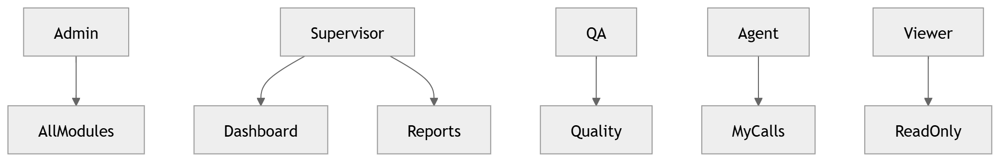

# 49 · RBAC

> **Section:** [Backend & API](../../backend/overview.md) &nbsp;|&nbsp; **Diagram ID:** `49`

## Purpose

Role-based access control.

## Description

Roles, permissions and policy enforcement governing what each persona can see and do.

## Diagram

## Inputs

- Authenticated identity
- Policies

## Outputs

- Allow/deny decisions

## Dependencies

- Policy engine

## Business Value

Least-privilege access aligned to personas.

## Technical Notes

Consumes identities from authentication (48).

## Related Diagrams

- [48 · Authentication](../04_Backend/48_Authentication.md)
- [41 · API Gateway](../04_Backend/41_API_Gateway.md)
- [08 · Dashboard Modules](../01_System_Overview/08_Dashboard_Modules.md)

---

### Navigation

⬅ Previous: [48 · Authentication](../04_Backend/48_Authentication.md)  &nbsp;|&nbsp;  ⬆ [Diagram Index](../../architecture_index.md)  &nbsp;|&nbsp;  ➡ Next: [50 · Backend Overview](../04_Backend/50_Backend_Overview.md)
