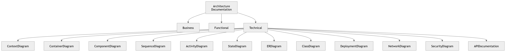

# P10 · Documentation

> **Section:** [Product & Program Views](../../product/overview.md) &nbsp;|&nbsp; **Diagram ID:** `P10`

## Purpose

Documentation program board.

## Description

How the documentation set itself is organized and produced.

## Diagram

## Inputs

- Diagrams
- Metadata

## Outputs

- Documentation system view

## Dependencies

- Docs toolchain

## Business Value

Meta-view of this very repository.

## Technical Notes

Realized by the scripts in scripts/.

## Related Diagrams

- [01 · System Context Diagram](../01_System_Overview/01_System_Context_Diagram.md)
- [02 · High Level Architecture](../01_System_Overview/02_High_Level_Architecture.md)

---

### Navigation

⬅ Previous: [P9 · Operational Flow](../05_Product/P9_Operational_Flow.md)  &nbsp;|&nbsp;  ⬆ [Diagram Index](../../architecture_index.md)  &nbsp;|&nbsp;  ➡ Next: [P11 · Database Program View](../05_Product/P11_Database_Program_View.md)
