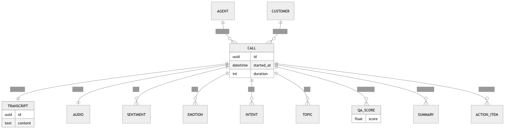

# P11 · Database Program View

> **Section:** [Product & Program Views](../../product/overview.md) &nbsp;|&nbsp; **Diagram ID:** `P11`

## Purpose

Database program board.

## Description

Program-level framing of the data platform.

## Diagram

## Inputs

- Storage topology

## Outputs

- Data program view

## Dependencies

- Data tier

## Business Value

Business framing of the storage strategy.

## Technical Notes

Expands the database architecture (31).

## Related Diagrams

- [31 · Database Architecture](../03_Data_Architecture/31_Database_Architecture.md)
- [39 · Analytics Warehouse](../03_Data_Architecture/39_Analytics_Warehouse.md)
- [34 · Feature Store](../03_Data_Architecture/34_Feature_Store.md)
- [35 · Vector Search](../03_Data_Architecture/35_Vector_Search.md)

---

### Navigation

⬅ Previous: [P10 · Documentation](../05_Product/P10_Documentation.md)  &nbsp;|&nbsp;  ⬆ [Diagram Index](../../architecture_index.md)  &nbsp;|&nbsp;  ➡ Next: [P12 · Infrastructure](../05_Product/P12_Infrastructure.md)
