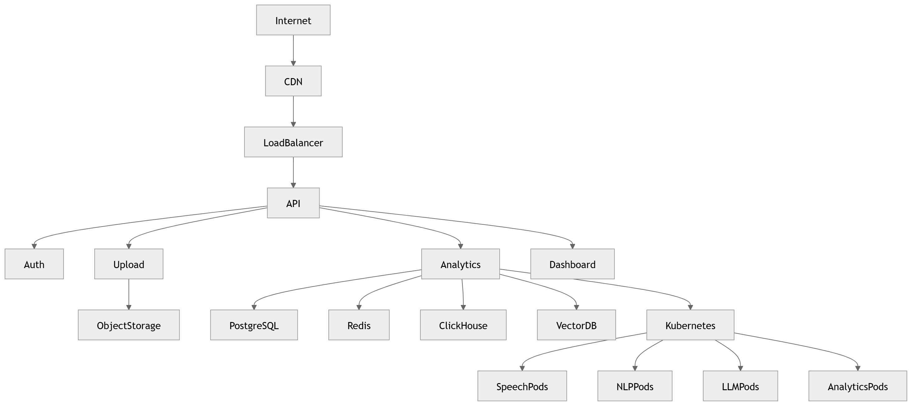

# P12 · Infrastructure

> **Section:** [Product & Program Views](../../product/overview.md) &nbsp;|&nbsp; **Diagram ID:** `P12`

## Purpose

Infrastructure program board.

## Description

Compute, networking, Kubernetes and cloud infrastructure underpinning the platform.

## Diagram

## Inputs

- Workloads

## Outputs

- Infrastructure view

## Dependencies

- Cloud
- Kubernetes

## Business Value

Foundation for deployment and scaling.

## Technical Notes

Hosts the containers from the container diagram (3).

## Related Diagrams

- [03 · Container Diagram](../01_System_Overview/03_Container_Diagram.md)
- [50 · Backend Overview](../04_Backend/50_Backend_Overview.md)
- [46 · Event Driven Backend](../04_Backend/46_Event_Driven_Backend.md)

---

### Navigation

⬅ Previous: [P11 · Database Program View](../05_Product/P11_Database_Program_View.md)  &nbsp;|&nbsp;  ⬆ [Diagram Index](../../architecture_index.md)  &nbsp;|&nbsp;  ➡ Next: [P13 · Security](../05_Product/P13_Security.md)
