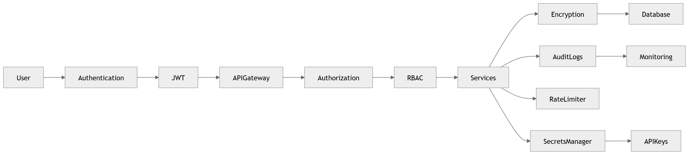

# P13 · Security

> **Section:** [Product & Program Views](../../product/overview.md) &nbsp;|&nbsp; **Diagram ID:** `P13`

## Purpose

Security program board.

## Description

Security posture: identity, encryption, audit and monitoring across the platform.

## Diagram

## Inputs

- Security controls

## Outputs

- Security view

## Dependencies

- IdP
- KMS
- SIEM

## Business Value

Holistic security and compliance framing.

## Technical Notes

Builds on authentication (48) and RBAC (49).

## Related Diagrams

- [48 · Authentication](../04_Backend/48_Authentication.md)
- [49 · RBAC](../04_Backend/49_RBAC.md)
- [40 · Data Lifecycle](../03_Data_Architecture/40_Data_Lifecycle.md)

---

### Navigation

⬅ Previous: [P12 · Infrastructure](../05_Product/P12_Infrastructure.md)  &nbsp;|&nbsp;  ⬆ [Diagram Index](../../architecture_index.md)  &nbsp;|&nbsp;  ➡ Next: [P14 · Product Features](../05_Product/P14_Product_Features.md)
