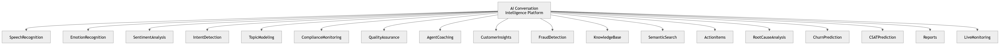

# P14 · Product Features

> **Section:** [Product & Program Views](../../product/overview.md) &nbsp;|&nbsp; **Diagram ID:** `P14`

## Purpose

Product features program board.

## Description

The product feature set and how architecture enables it.

## Diagram

## Inputs

- Capabilities

## Outputs

- Feature program view

## Dependencies

- All platform capabilities

## Business Value

Ties architecture to customer-facing value.

## Technical Notes

Top-level product framing.

## Related Diagrams

- [08 · Dashboard Modules](../01_System_Overview/08_Dashboard_Modules.md)
- [22 · Conversation Intelligence](../02_AI_Pipeline/22_Conversation_Intelligence.md)
- [24 · QA Evaluation](../02_AI_Pipeline/24_QA_Evaluation.md)
- [27 · Coaching Recommendation](../02_AI_Pipeline/27_Coaching_Recommendation.md)

---

### Navigation

⬅ Previous: [P13 · Security](../05_Product/P13_Security.md)  &nbsp;|&nbsp;  ⬆ [Diagram Index](../../architecture_index.md)
