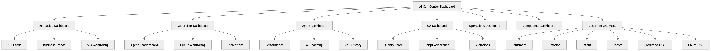

# P6 · Dashboard Business Analytics

> **Section:** [Product & Program Views](../../product/overview.md) &nbsp;|&nbsp; **Diagram ID:** `P6`

## Purpose

Dashboard & business-analytics program board.

## Description

Program-level view of the dashboard and analytics product surface and the value it delivers.

## Diagram

## Inputs

- Analytics
- Conversation intelligence

## Outputs

- Product/dashboard roadmap view

## Dependencies

- Dashboard modules
- Analytics

## Business Value

Connects engineering to product/business framing.

## Technical Notes

Expands the dashboard modules diagram (8).

## Related Diagrams

- [08 · Dashboard Modules](../01_System_Overview/08_Dashboard_Modules.md)
- [09 · Analytics Architecture](../01_System_Overview/09_Analytics_Architecture.md)
- [25 · Business Intelligence](../02_AI_Pipeline/25_Business_Intelligence.md)
- [44 · Dashboard Request](../04_Backend/44_Dashboard_Request.md)

---

### Navigation

⬅ Previous: [50 · Backend Overview](../04_Backend/50_Backend_Overview.md)  &nbsp;|&nbsp;  ⬆ [Diagram Index](../../architecture_index.md)  &nbsp;|&nbsp;  ➡ Next: [P7 · AI Models](../05_Product/P7_AI_Models.md)
