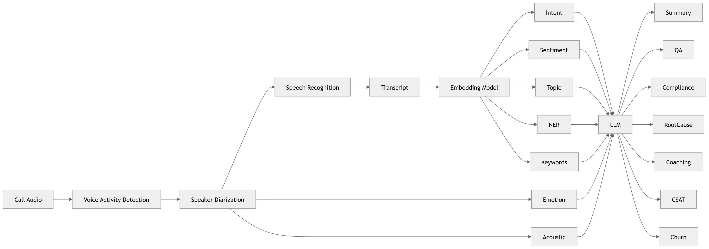

# P7 · AI Models

> **Section:** [Product & Program Views](../../product/overview.md) &nbsp;|&nbsp; **Diagram ID:** `P7`

## Purpose

AI models program board.

## Description

Inventory and framing of the AI/ML models powering the platform.

## Diagram

## Inputs

- Model catalog

## Outputs

- Model program view

## Dependencies

- AI services

## Business Value

Portfolio view of model investments.

## Technical Notes

Maps to the AI service architecture (7).

## Related Diagrams

- [07 · AI Service Architecture](../01_System_Overview/07_AI_Service_Architecture.md)
- [11 · End to End AI Pipeline](../02_AI_Pipeline/11_End_to_End_AI_Pipeline.md)
- [23 · LLM Orchestration](../02_AI_Pipeline/23_LLM_Orchestration.md)
- [26 · Prediction Engine](../02_AI_Pipeline/26_Prediction_Engine.md)

---

### Navigation

⬅ Previous: [P6 · Dashboard Business Analytics](../05_Product/P6_Dashboard_Business_Analytics.md)  &nbsp;|&nbsp;  ⬆ [Diagram Index](../../architecture_index.md)  &nbsp;|&nbsp;  ➡ Next: [P8 · ML MLOps](../05_Product/P8_ML_MLOps.md)
