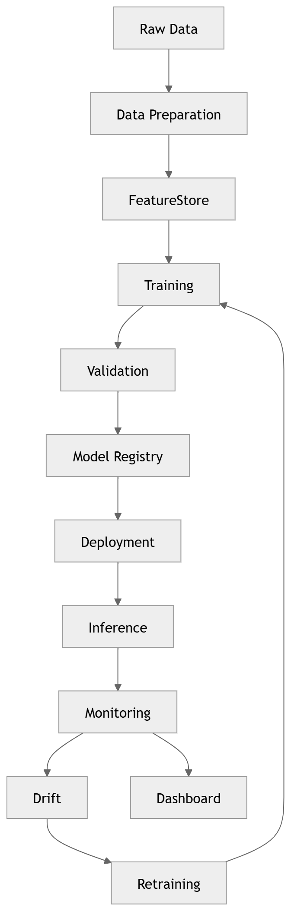

# P8 · ML MLOps

> **Section:** [Product & Program Views](../../product/overview.md) &nbsp;|&nbsp; **Diagram ID:** `P8`

## Purpose

ML & MLOps program board.

## Description

The ML lifecycle: training, registry, deployment, monitoring and retraining.

## Diagram

## Inputs

- Training data
- Models

## Outputs

- MLOps lifecycle view

## Dependencies

- Feature store
- Model registry
- CI/CD

## Business Value

Operational rigor around the model lifecycle.

## Technical Notes

Relies on the feature store (34).

## Related Diagrams

- [34 · Feature Store](../03_Data_Architecture/34_Feature_Store.md)
- [07 · AI Service Architecture](../01_System_Overview/07_AI_Service_Architecture.md)
- [26 · Prediction Engine](../02_AI_Pipeline/26_Prediction_Engine.md)
- [35 · Vector Search](../03_Data_Architecture/35_Vector_Search.md)

---

### Navigation

⬅ Previous: [P7 · AI Models](../05_Product/P7_AI_Models.md)  &nbsp;|&nbsp;  ⬆ [Diagram Index](../../architecture_index.md)  &nbsp;|&nbsp;  ➡ Next: [P9 · Operational Flow](../05_Product/P9_Operational_Flow.md)
