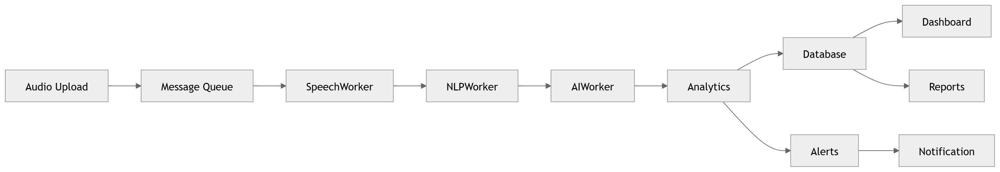

# P9 · Operational Flow

> **Section:** [Product & Program Views](../../product/overview.md) &nbsp;|&nbsp; **Diagram ID:** `P9`

## Purpose

Operational flow program board.

## Description

Day-2 operational flows across the platform.

## Diagram

## Inputs

- Operational signals

## Outputs

- Ops flow view

## Dependencies

- Backend
- Monitoring

## Business Value

Shapes runbooks and on-call.

## Technical Notes

Complements the processing sequence (43).

## Related Diagrams

- [43 · Processing Sequence](../04_Backend/43_Processing_Sequence.md)
- [46 · Event Driven Backend](../04_Backend/46_Event_Driven_Backend.md)
- [50 · Backend Overview](../04_Backend/50_Backend_Overview.md)

---

### Navigation

⬅ Previous: [P8 · ML MLOps](../05_Product/P8_ML_MLOps.md)  &nbsp;|&nbsp;  ⬆ [Diagram Index](../../architecture_index.md)  &nbsp;|&nbsp;  ➡ Next: [P10 · Documentation](../05_Product/P10_Documentation.md)
