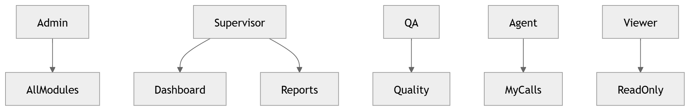

# Security · Authorization

Role-based access control and policy enforcement.

### 49 · [RBAC](../diagrams/04_Backend/49_RBAC.md)

Role-based access control.

---

[⬆ Diagram Index](../architecture_index.md) &nbsp;|&nbsp; [🏠 Home](../index.md)
