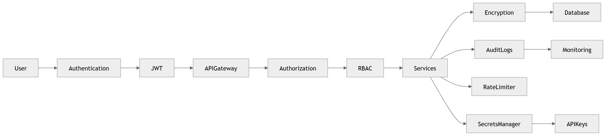
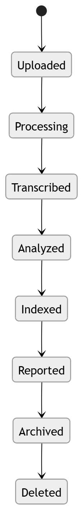

# Encryption

Encryption in transit and at rest, key management.

### P13 · [Security](../diagrams/05_Product/P13_Security.md)

Security program board.

### 40 · [Data Lifecycle](../diagrams/03_Data_Architecture/40_Data_Lifecycle.md)

Data lifecycle & retention.

---

[⬆ Diagram Index](../architecture_index.md) &nbsp;|&nbsp; [🏠 Home](../index.md)
