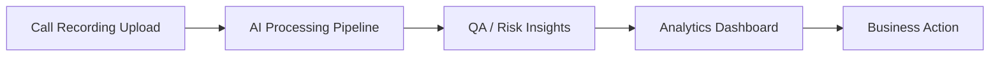
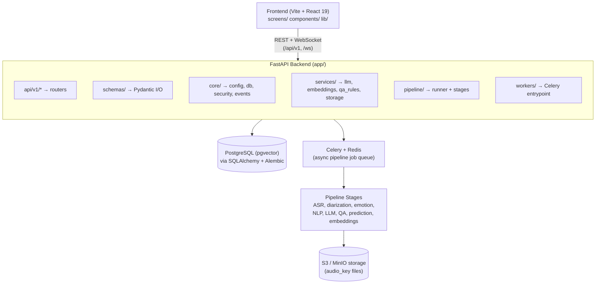
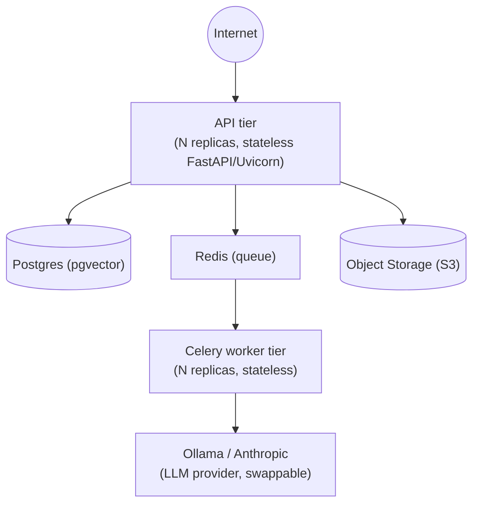

# Enterprise Architecture Document (Phase P3)

**Product:** Sonic — AI Conversation Intelligence Platform
**Scope:** Multi-tenant SaaS that ingests call-center audio, runs it through an AI pipeline (ASR → diarization → emotion → NLP → LLM summarization → QA scoring → prediction → indexing), and surfaces analytics/search to tenant users.

---

## 1. Business Architecture

**Actors:** Platform Admin (cross-tenant), Tenant Admin, Manager, Agent (per `Role` enum: `admin`, `manager`, `agent`, plus a `platform_admin` flag).

**Core business capabilities:**
- Upload/manage call recordings per tenant
- Automated transcription, speaker diarization, emotion tagging
- LLM-generated call summaries
- Rule-based QA scoring against configurable compliance rules
- Risk/outcome prediction per conversation
- Analytics rollups (volume, compliance, risk, agent performance)
- Semantic search across processed conversations
- Billing/subscription management (plan, invoices — stubbed, no live payment provider)
- In-app + email notifications on pipeline events (QA failures, risk spikes)

**Business value chain:**

Tenancy is the core business boundary: every entity (conversations, segments, metrics, notifications) is scoped to a `tenant_id`, enabling the platform to serve multiple customer organizations from one deployment.

---

## 2. Application Architecture

**Layering:** routers (`api/v1`) depend only on `schemas` + `services`/`models` via dependency injection (`api/deps.py`); pipeline stages are pure functions orchestrated by `pipeline/runner.py` and invoked from Celery workers, decoupling long-running AI work from the request/response cycle.

---

## 3. Technology Architecture

| Layer | Technology |
|---|---|
| Frontend | React 19, React Router 7, Vite 8, Tailwind CSS 4, framer-motion |
| Backend API | Python 3.11+, FastAPI, Uvicorn, Pydantic v2 |
| ORM / Migrations | SQLAlchemy 2.0 (async), Alembic |
| Database | PostgreSQL 16 (pgvector extension) |
| Async job queue | Celery + Redis |
| Object storage | S3-compatible (boto3), MinIO in dev/docker-compose |
| Auth | PyJWT (HS256), PBKDF2 password hashing |
| Observability | Prometheus instrumentator, structured logging (`core/logging.py`) |
| Testing | pytest (backend), Vitest + Testing Library + Playwright (frontend) |
| Lint/type-check | ruff, mypy |

---

## 4. Cloud Architecture

Deployment is containerized and cloud-portable rather than tied to one provider:

- **`backend/Dockerfile`** — multi-stage build (`builder` / `runtime` / `api` / `worker` targets), with an `INSTALL_ML_EXTRAS` build arg to include heavy ML dependencies only where needed (keeps the base API image lean).
- **`backend/docker-compose.yml`** — local/reference topology: Postgres (pgvector image), Redis, MinIO (S3-compatible object store), Ollama (GPU-enabled LLM runtime), API service, Celery worker service.
- **Statelessness:** API and worker containers are stateless; state lives in Postgres, Redis (queue/cache), and object storage — enabling horizontal scaling of API and worker replicas independently.
- **Config via environment:** all runtime config is `SONIC_`-prefixed env vars (`core/config.py`), making the same image portable across environments (dev/staging/prod) and cloud providers (AWS S3, GCS via S3-compatible shims, etc.).

---

## 5. AI Architecture

Pipeline stages run sequentially per conversation (`app/pipeline/stages.py`, orchestrated by `runner.py`), each independently feature-flagged (`SONIC_ENABLE_*`) with a cheap deterministic fallback so the pipeline degrades gracefully rather than failing outright:

| Stage | Primary approach | Fallback |
|---|---|---|
| ASR | `banglaspeech2text` (Whisper-based, Bangla) | `faster-whisper` |
| Diarization | `pyannote.audio` (`pyannote/speaker-diarization-3.1`) | skipped, single-speaker segment |
| Emotion | `speechbrain` (`emotion-recognition-wav2vec2-IEMOCAP`) | neutral score stub |
| NLP / entities | `spacy` (`en_core_web_sm`) | skipped |
| LLM summarization | Ollama (local, `mistral`, structured JSON) or Anthropic Claude | — |
| QA scoring | Rule-based engine, YAML-configured (`rules/qa_rules.yaml`) | — |
| Prediction | Heuristic scoring (`_heuristic_predict`) | — |
| Embeddings/Indexing | Hashed bag-of-words (256-dim) deterministic vectors | swappable for sentence-transformers |

Every stage execution is recorded as a `StageRun` row (status: `ok`/`failed`/`skipped`/`fallback`, duration) — giving full observability into which stages ran for real vs. fell back, per conversation. See [AI Governance Document](04-ai-governance.md) for model-level detail.

---

## 6. Security Architecture

See the dedicated [Security Architecture Document](08-security-architecture.md) for the full RBAC matrix and audit log spec. Summary:

- JWT (HS256) access + refresh tokens; PBKDF2-HMAC-SHA256 password hashing.
- Role-based authorization at the route level (`require_role`, `require_platform_admin` in `api/deps.py`).
- Tenant isolation enforced at two layers: application-level `tenant_id` filtering, plus Postgres Row-Level Security (RLS) as defense-in-depth (`get_tenant_db` sets `sonic.tenant_id` session config).

---

## 7. Data Architecture

Postgres is the system of record; see the full [Database Design](02-database-design.md) for ERD and data dictionary. Key principles:

- Every tenant-scoped table carries `tenant_id` for isolation.
- Raw audio lives in object storage (`audio_key`); Postgres stores metadata, transcripts, and derived AI outputs (JSON columns for `llm_summary`, `qa_result`, `prediction`, `embedding`).
- `TenantMetrics` is a denormalized rollup table, updated on pipeline completion, to keep analytics reads cheap.

---

## 8. Integration Architecture

| Integration | Direction | Mechanism |
|---|---|---|
| Frontend ↔ Backend | Bidirectional | REST (`/api/v1/*`) + WebSocket (`/ws/conversations/{id}`) for live pipeline-stage progress |
| Backend ↔ Object storage | Outbound | S3 API (boto3) — audio upload/retrieval |
| Backend ↔ LLM provider | Outbound | Ollama HTTP API (local/self-hosted, default) or Anthropic API (`ANTHROPIC_API_KEY`, opt-in) |
| Backend ↔ Job queue | Internal | Celery producer (API) / consumer (worker) over Redis |
| Backend ↔ Billing provider | Outbound (planned) | Currently stubbed — `Plan`/`Subscription`/`Invoice` tables exist with no live payment processor wired up |

Full endpoint-level detail is in the [API Specification](03-api-specification.md).
