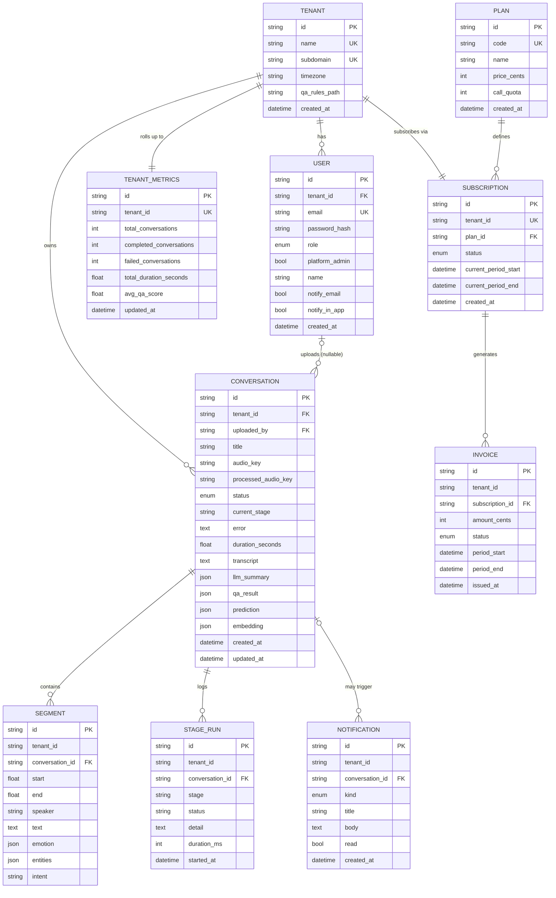

# Database Design (Phase P5)

**Engine:** PostgreSQL 16 (`pgvector` extension enabled for future native vector search).
**ORM/Migrations:** SQLAlchemy 2.0 (async) models in `backend/app/models/__init__.py`; Alembic migrations in `backend/alembic/versions/` (`0001_initial` → `0005_billing`).
**Multi-tenancy:** row-level isolation via a `tenant_id` column on every tenant-scoped table, enforced in application queries and by Postgres RLS (`sonic.tenant_id` session variable — see [Security Architecture](08-security-architecture.md)).

---

## 1. Entity-Relationship Diagram

**Notes on cardinality:**
- Tenant 1─N User, 1─N Conversation, 1─1 TenantMetrics, 1─1 Subscription.
- Conversation 1─N Segment (cascade delete), 1─N StageRun (cascade delete), 0─N Notification.
- User 0─N Conversation (as `uploaded_by`, nullable — conversation can outlive/precede a user reference).
- Plan 1─N Subscription; Subscription 1─N Invoice.

---

## 2. Data Dictionary

### `tenants`
| Field | Type | Constraints |
|---|---|---|
| id | varchar(36) | PK, UUID default |
| name | varchar(255) | unique, not null |
| subdomain | varchar(63) | unique, not null |
| timezone | varchar(64) | default `"UTC"` |
| qa_rules_path | varchar(512) | nullable — overrides global QA rules file per tenant |
| created_at | timestamptz | default now |

### `users`
| Field | Type | Constraints |
|---|---|---|
| id | varchar(36) | PK, UUID default |
| tenant_id | varchar(36) | FK → tenants.id, indexed, not null |
| email | varchar(255) | unique, indexed, not null |
| password_hash | varchar(255) | not null, PBKDF2-HMAC-SHA256 |
| role | enum(`admin`,`manager`,`agent`) | default `agent` |
| platform_admin | boolean | default false — cross-tenant superuser flag |
| name | varchar(255) | nullable |
| notify_email | boolean | default true |
| notify_in_app | boolean | default true |
| created_at | timestamptz | default now |

### `conversations`
| Field | Type | Constraints |
|---|---|---|
| id | varchar(36) | PK, UUID default |
| tenant_id | varchar(36) | FK → tenants.id, indexed, not null |
| uploaded_by | varchar(36) | FK → users.id, nullable |
| title | varchar(255) | default `"Untitled call"` |
| audio_key | varchar(512) | nullable — object storage key for raw audio |
| processed_audio_key | varchar(512) | nullable |
| status | enum(`uploaded`,`processing`,`completed`,`failed`) | indexed, default `uploaded` |
| current_stage | varchar(64) | nullable — pipeline stage name in progress |
| error | text | nullable |
| duration_seconds | float | nullable |
| transcript | text | nullable |
| llm_summary | json | nullable — LLM output object |
| qa_result | json | nullable — QA rule engine output |
| prediction | json | nullable — outcome/risk prediction |
| embedding | json | nullable — 256-dim vector (candidate for native `pgvector` column) |
| created_at / updated_at | timestamptz | default now / on-update now |

### `segments`
| Field | Type | Constraints |
|---|---|---|
| id | varchar(36) | PK |
| tenant_id | varchar(36) | indexed, not null |
| conversation_id | varchar(36) | FK → conversations.id, indexed, cascade delete |
| start / end | float | default 0.0 — timestamp offsets in seconds |
| speaker | varchar(64) | default `"SPEAKER_00"` — diarization label |
| text | text | default `""` |
| emotion | json | nullable — per-segment emotion scores |
| entities | json | nullable — NER output |
| intent | varchar(64) | nullable |

### `stage_runs`
| Field | Type | Constraints |
|---|---|---|
| id | varchar(36) | PK |
| tenant_id | varchar(36) | indexed |
| conversation_id | varchar(36) | FK → conversations.id, indexed, cascade delete |
| stage | varchar(64) | not null — e.g. `asr`, `diarization`, `emotion`, `llm`, `qa` |
| status | varchar(32) | default `pending`; one of `ok`/`failed`/`skipped`/`fallback` |
| detail | text | nullable — error/fallback reason |
| duration_ms | integer | nullable |
| started_at | timestamptz | default now |

### `notifications`
| Field | Type | Constraints |
|---|---|---|
| id | varchar(36) | PK |
| tenant_id | varchar(36) | indexed |
| conversation_id | varchar(36) | FK → conversations.id, nullable |
| kind | enum(`error`,`warning`,`info`,`success`) | default `info` |
| title | varchar(255) | not null |
| body | text | not null |
| read | boolean | default false |
| created_at | timestamptz | default now, indexed |

### `tenant_metrics`
| Field | Type | Constraints |
|---|---|---|
| id | varchar(36) | PK |
| tenant_id | varchar(36) | unique, indexed — one row per tenant |
| total_conversations | integer | default 0 |
| completed_conversations | integer | default 0 |
| failed_conversations | integer | default 0 |
| total_duration_seconds | float | default 0.0 |
| avg_qa_score | float | nullable |
| updated_at | timestamptz | default now / on-update now |

### `plans`
| Field | Type | Constraints |
|---|---|---|
| id | varchar(36) | PK |
| code | varchar(32) | unique, indexed |
| name | varchar(64) | not null |
| price_cents | integer | nullable — `NULL` = "Custom" (Enterprise tier) |
| call_quota | integer | nullable — `NULL` = unlimited |
| created_at | timestamptz | default now |

### `subscriptions`
| Field | Type | Constraints |
|---|---|---|
| id | varchar(36) | PK |
| tenant_id | varchar(36) | unique, indexed — one active subscription per tenant |
| plan_id | varchar(36) | FK → plans.id |
| status | enum(`active`,`canceled`) | default `active` |
| current_period_start | timestamptz | default now |
| current_period_end | timestamptz | default now+30 days |
| created_at | timestamptz | default now |

### `invoices`
| Field | Type | Constraints |
|---|---|---|
| id | varchar(36) | PK |
| tenant_id | varchar(36) | indexed |
| subscription_id | varchar(36) | FK → subscriptions.id |
| amount_cents | integer | default 0 |
| status | enum(`paid`,`due`) | default `due` |
| period_start / period_end | timestamptz | not null |
| issued_at | timestamptz | default now, indexed |

> **Note:** `plans`/`subscriptions`/`invoices` are functional data models but no live payment provider is integrated yet — amounts are derived from `Plan.price_cents`, not charged.

---

## 3. Migration History

| Migration | Purpose |
|---|---|
| `0001_initial` | Core schema: tenants, users, conversations, segments, stage_runs |
| `0002_notifications` | Adds `notifications` table |
| `0003_platform_admin` | Adds `platform_admin` flag to `users` |
| `0004_settings` | Adds per-tenant/per-user settings fields (timezone, qa_rules_path, notify flags) |
| `0005_billing` | Adds `plans`, `subscriptions`, `invoices` |
