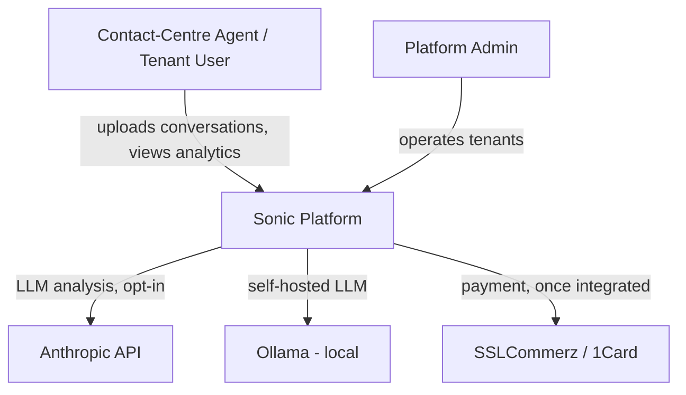
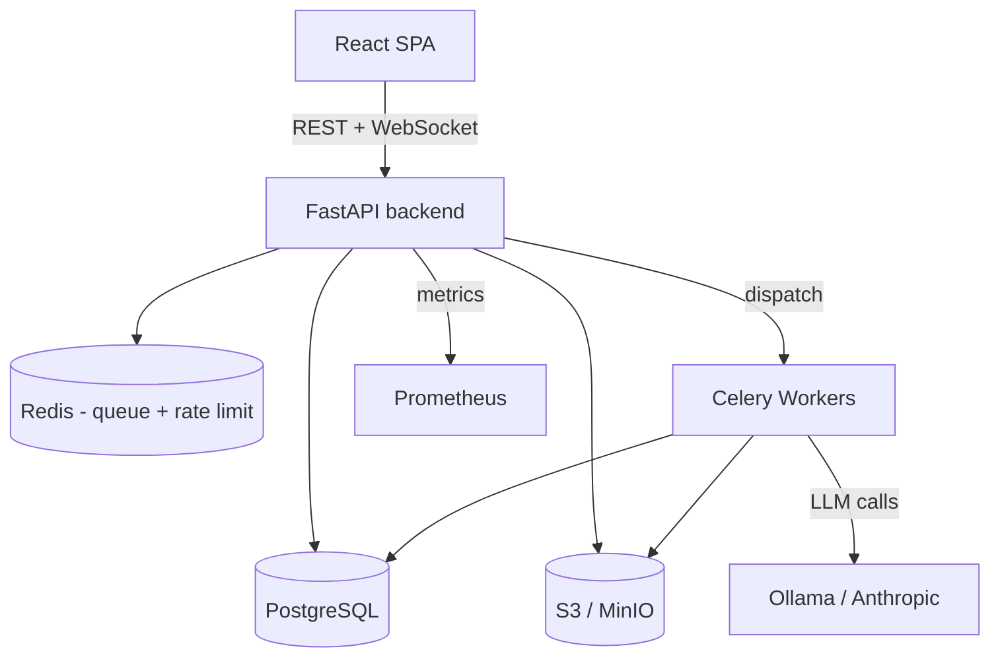
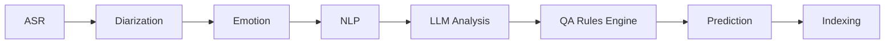
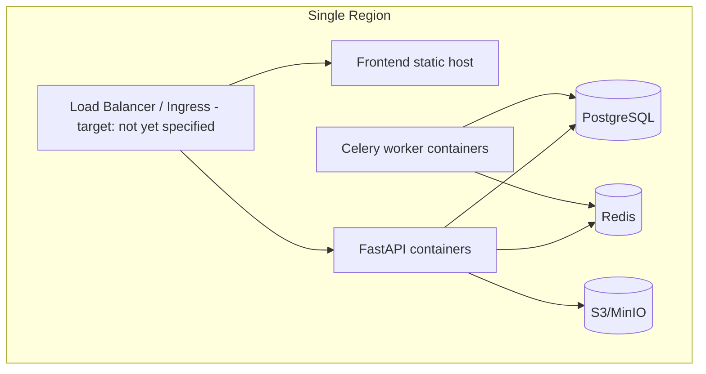

# Master Document 14 — Enterprise Architecture

**Controls covered:** P3-01 (Enterprise architecture layers designed), P3-05 (Modular, scalable, extensible design demonstrated), P6A-01 (Tech stack comparison), P6A-02 (C4/deployment/data-flow diagrams), P6A-03 (Backend engineering spec), P6A-04 (Frontend engineering spec), P6A-08 (Infrastructure spec), P6A-09 (DevSecOps spec), P6A-10 (Observability spec), P6A-11 (Performance spec), P6A-12 (Technical documentation), P6A-13 (Engineering quality gate), P10-03 (Environment strategy), P10-04 (Monitoring, logging & tracing — same evidence as P6A-10)
**Phase:** 3 — Enterprise Architecture
**Status:** Draft — current-state architecture evidenced; target-state gap analysis included

## 1. Current (implemented) architecture

```
Frontend (React 19 / Vite / Tailwind)
        │  REST + WebSocket
        ▼
FastAPI backend (app/api/v1/*, prefix "/api/v1")
        │
   ┌────┼─────────────────────────┐
   ▼    ▼                         ▼
Postgres  Celery workers ── Redis   S3/MinIO (boto3)
(SQLAlchemy      │  (async pipeline
 async, Alembic)  │   execution, on-demand
                  │   dispatch — no scheduled/
                  │   beat tasks)
                  ▼
        app/pipeline/ (ASR → diarization → emotion →
        NLP → LLM → QA → prediction → indexing)
                  │
                  ▼
        LLM provider abstraction (app/services/llm.py):
        Ollama (local, default) | Anthropic Claude (SONIC_LLM_PROVIDER)
```

- **Presentation layer**: React 19 SPA, Vite build, Tailwind styling, React Router 7.
- **API layer**: FastAPI, versioned under a single literal `/api/v1` prefix (`app/api/v1/router.py`), routes split by domain (auth, team, onboarding, leads, settings, analytics, health, ws, notifications, platform, platform_auth, conversations, billing, search).
- **Data layer**: single `app/models/__init__.py` module defining all SQLAlchemy models — see Master Document 18 for full schema detail.
- **Async processing layer**: Celery + Redis drive pipeline stage execution outside the request/response cycle (on-demand dispatch only — no periodic/beat scheduling, see Master Document 24).
- **Storage layer**: boto3 against S3/MinIO-compatible object storage.
- **Observability layer**: Prometheus metrics via `prometheus-fastapi-instrumentator`.

## 2. Modularity/scalability/extensibility evidence (P3-05)
- **Modular pipeline**: each of the 8 pipeline stages is independently feature-flagged (`enable_asr`, `enable_diarization`, etc. in `app/core/config.py`) — stages can be enabled/disabled without code changes, demonstrating extensibility.
- **Provider abstraction**: the LLM layer swaps providers (Ollama ↔ Anthropic) via a single config value (`SONIC_LLM_PROVIDER`), not a code branch scattered across the codebase — demonstrates a clean extension point for adding future providers.
- **Layered auth scopes**: platform vs. tenant token scopes are architecturally separated (SON-64), not just role-flag-differentiated — a scalable pattern for adding further scope types later without cross-contamination risk.
- **Async task boundary**: pipeline execution is decoupled from the request/response cycle via Celery, allowing the pipeline to scale independently of API request volume.

## 3. Target (documented, not yet implemented) architecture
`TECH_STACK.md` and the separate `AI-Conversation-Intelligence-Architecture/` project describe a larger target state: Kong API gateway, Kafka event streaming, Triton inference server, Keycloak identity, ClickHouse analytics store, LangChain-based LLM orchestration, LLM-as-judge QA. **None of this is implemented in `backend/` today.**

## 4. Gap analysis

| Target component | Current substitute | Gap | Scale trigger to revisit |
|---|---|---|---|
| Kong gateway | Direct FastAPI ingress | No gateway-level auth/rate-limit/routing layer | Multiple backend services needing shared ingress policy |
| Kafka | Celery + Redis | No durable event log/replay; Celery queues are ephemeral dispatch, not an event store | Need for event replay, multi-consumer fan-out, or cross-service event sourcing |
| Triton inference server | In-process/API-based LLM calls (Ollama/Anthropic) | No dedicated model-serving infra | High-throughput self-hosted model inference becomes the cost/latency bottleneck |
| Keycloak | Custom JWT/PyJWT auth | No SSO/enterprise-IdP federation | Enterprise customers require SAML/OIDC SSO |
| ClickHouse | Postgres | Analytics queries run against the transactional store | Analytics query load measurably degrades transactional performance |

## 5. Recommendation
Treat the target architecture as a scale-driven roadmap, not a Phase-1 requirement. Each gap-table row should become its own scoped initiative only when its trigger condition is met — avoid building ahead of demonstrated need (consistent with C0-05, Reuse Before Rebuild, and general architectural discipline).

## Part B — Technical Engineering Specifications (P6A cluster)

### P6A-01 — Technology stack comparison
| Layer | Chosen | Alternatives considered | Rationale |
|---|---|---|---|
| Backend framework | FastAPI | Django REST, Flask | Async-native (matches Celery/pipeline concurrency needs), automatic OpenAPI generation (feeds P6A-07), smaller learning curve for a 4-person team than Django's full-stack surface |
| Frontend | React 19 / Vite / Tailwind | Vue, Svelte | Largest hiring pool/ecosystem for a DIU student team transitioning to industry; Vite's dev-server speed suits rapid iteration |
| Database | PostgreSQL | MySQL, MongoDB | Relational integrity needed for tenant/billing/audit data (P5-04); JSON column support covers semi-structured pipeline output without needing a second document store |
| Async/queue | Celery + Redis | Kafka (target-state, see §3/§4), RQ | Redis already used for rate-limiting (Master Doc 15); Celery is the standard Python-ecosystem choice, lower operational overhead than Kafka at current scale |
| LLM providers | Ollama (local) / Anthropic (opt-in) | OpenAI, self-hosted-only | Dual-path balances data-residency (Ollama) against production-grade quality/scale (Anthropic) — see Master Doc 16 A.2 |
| Storage | S3/MinIO-compatible | Local filesystem, GCS | Object storage abstraction allows dev (MinIO) and production (any S3-compatible provider) to share the same `boto3` interface |

Scoring dimensions (performance, scalability, maintainability, cost) were applied qualitatively per row above rather than as a numeric matrix — proportionate to a 4-person team; a numeric weighted-scoring exercise is a reasonable addition only if a stack decision becomes contested internally.

### P6A-02 — System architecture diagrams (C4 model)

**Level 1 — System Context:**


**Level 2 — Container:**


**Level 3 — Component (pipeline detail, extends Master Doc 16 A.1):**


**Deployment (current-state, single-region):**

The deployment diagram's Load Balancer/Ingress target is marked unspecified deliberately — this is the concrete gap closed by P6A-08 below, not fabricated here.

### P6A-03 — Backend engineering specification
- **Folder structure**: `app/api/v1/*` (routes by domain), `app/core/*` (config, security, tenant resolution), `app/models/` (single SQLAlchemy module, see Master Doc 18), `app/pipeline/` (stage orchestration), `app/services/` (LLM, embeddings, QA rules), `app/prompts/` (once P7-01 lands). Convention: a new domain gets a route module + optional service module, not a full new package, until it's large enough to warrant one.
- **Dependency injection**: FastAPI's native `Depends()` for auth/tenant-scope resolution and DB session injection — no separate DI framework, consistent with reuse-before-build.
- **Caching**: Redis is currently used for rate-limiting only; no query-result caching layer exists. **Recommendation**: introduce read-through caching only when a specific endpoint's DB load is measured as a bottleneck (ties to P6A-11 performance targets below) — not speculatively.
- **Error handling**: FastAPI exception handlers should return a consistent envelope (`{error: {code, message}}`); `LLMUnavailable` (Master Doc 16) is the model for graceful-degradation error handling elsewhere.
- **Logging**: structured logging (JSON) recommended for production, keyed by `tenant_id`/`request_id` where available, to support the observability spec below (P6A-10).

### P6A-04 — Frontend engineering specification
- **Component library**: internal, Tailwind-based (see Master Doc 31, P4-02) — no third-party component-library dependency beyond what's already in `frontend/package.json`.
- **State management**: React Query (or equivalent) for server-state (API data), React context/local state for UI-only state — avoids introducing a heavier global-state library (Redux) unless cross-cutting client state genuinely emerges.
- **Routing**: React Router 7, route-guarded by auth scope (tenant vs platform-admin), mirroring the backend's scope separation (Master Doc 15 A.1).
- **Theming**: Tailwind config as the single design-token source (Master Doc 31 §P4-02.1).
- **Accessibility**: WCAG 2.1 AA target and `eslint-plugin-jsx-a11y` enforcement — see Master Doc 31 for the full spec (not duplicated here).

### P6A-08 — Infrastructure engineering specification
**Status: Spec defined; specific cloud provider selection remains open (not yet a business decision).**
- **Deployment target**: containerized (Docker, already evidenced in CI) — Kubernetes is the target-state per §3/§4 above, triggered by the same scale conditions (not before).
- **DNS/SSL**: subdomain-per-tenant (`{tenant}.sonic.example`) requires wildcard DNS + wildcard TLS certificate — this is a hard operational prerequisite for the host-based tenant resolution feature (Master Doc 15 D-01) to work correctly once enabled; **flagged as a deployment blocker for D-01's fix**, not just a nice-to-have.
- **Load balancer**: terminates TLS, routes to the FastAPI container tier; sizing/provider TBD pending cloud-provider selection.
- **Scaling strategy**: horizontal scaling of stateless FastAPI/Celery-worker containers behind the load balancer; PostgreSQL/Redis scale vertically first, then via read-replicas/clustering once the P5-02 partitioning trigger (Master Doc 18) is hit.
- **DR infrastructure**: see Master Doc 15 P8-07 (RTO 4h/RPO 1h) — this section's job is deployment topology, that document's job is the recovery procedure; they must stay consistent as both are implemented.

### P6A-09 — DevSecOps engineering specification
- **Secrets management**: see Master Doc 15 P8-05 (env vars today, KMS/vault upgrade path specified there — not duplicated here).
- **Infrastructure as Code**: not yet adopted; **recommendation**: Terraform for cloud resources once the provider is selected (P6A-08), Kubernetes manifests/Helm once K8s migration is triggered — sequenced, not parallel efforts.
- **Rollback procedure**: container-image-tag-based rollback (redeploy the previous tag) is sufficient at current single-region, containerized scale; database-migration rollback follows Alembic's downgrade path, tested as part of the P10-03 environment-promotion process below.

### P6A-10 / P10-04 — Observability specification
- **Metrics**: Prometheus via `prometheus-fastapi-instrumentator` (existing) — extend with the `sonic_llm_tokens_total` counter (Master Doc 16 P7-07) and a `sonic_pipeline_stage_duration_seconds` histogram per stage.
- **Logging**: structured JSON logs (P6A-03), aggregated via whatever the chosen cloud provider's native log service is (provider TBD, P6A-08) — no separate ELK/Loki stack stood up speculatively.
- **Tracing**: not yet implemented; **recommendation**: OpenTelemetry instrumentation on the FastAPI→Celery boundary specifically (the hardest part of this system to debug, since a request and its async pipeline execution are decoupled) — highest-value tracing investment, not full end-to-end tracing on day one.
- **Alerting rules**: Prometheus Alertmanager rules for (a) pipeline-stage failure rate, (b) P7-06 failover events, (c) P5-02's partitioning-trigger metric, (d) credit-ledger exhaustion rate (P7-07) — each ties to a spec already written elsewhere in this document set, avoiding invented alerting scope.

### P6A-11 — Performance engineering specification
| Target | Value | Note |
|---|---|---|
| API p95 latency (non-pipeline endpoints) | < 500ms | Standard SaaS-API expectation; not yet benchmarked |
| Pipeline processing time (per conversation, all 8 stages) | Target TBD — requires a benchmark run against representative audio length | Directly feeds Master Doc 31's time-to-value target; must not be invented without a real measurement |
| Uptime | 99.9% (Q14, already decided) | Requires the instrumented SLA monitoring flagged as outstanding in Master Doc 6 |
| Concurrent tenant load | TBD | No load test executed yet — see Master Doc 25 P11-03 |

**Load/stress test plan**: see Master Document 25 (extended in this pass) — this document defines the *targets*, that document defines the *test execution plan*, avoiding duplication.

### P6A-12 — Technical documentation
This document set (30+ Master Documents) plus `README.md`/`TECH_STACK.md`/`getstarted.md`/`CONTRIBUTING.md` (Master Doc 21 §1) constitute the technical documentation corpus. **Explicitly still missing**: a standalone deployment guide and configuration guide (step-by-step, not narrative) — **recommendation**: author these once the infrastructure provider (P6A-08) is selected, since a deployment guide written against an undecided target would be speculative rather than evidence-based.

### P6A-13 — Engineering quality gate before coding
**Status: Retroactive for existing code (per C0-03's own acknowledgment); specified going forward.** Before a new major component begins implementation: (1) architecture doc updated (this document or a new ADR, Master Doc 17), (2) database changes reflected in the P5-01 ERD (Master Doc 18) before the migration is written, (3) API contract sketched (even informally) before the endpoint is coded, (4) this document set's relevant control section updated in the same PR or the immediately following one — enforced via the `.github/PULL_REQUEST_TEMPLATE.md` documentation-updated checkbox (already committed, Master Doc 20 P9-04).

## P10-03 — Environment strategy (dev/staging/prod)
**Status: Spec defined — closes a real gap; `SONIC_ENV` config flag exists but no formal strategy was documented.**
| Environment | Purpose | Promotion gate |
|---|---|---|
| Dev | Local development, Ollama-only (no Anthropic spend) | N/A — direct commit to feature branches |
| Staging | Pre-production validation, mirrors production config shape (including Anthropic path, using a low-volume test key) | CI green (lint/test/migration/secret-scan) + ≥1 CODEOWNERS-mapped review approval |
| Production | Live customer data | Staging soak period (minimum: one full release cycle without a P8-06 incident) + explicit CTO sign-off, logged in Master Doc 0's Change Control Register |

No staging environment is currently stood up — this is the concrete implementation gap; the promotion process above is ready to apply as soon as it exists. This also directly unblocks P10-01 (CD pipeline), which currently has no deployment target to promote to.

## 6. Outcome
- [ ] Architecture owner confirms current-state diagram and modularity evidence above are accurate
- [ ] Each gap-table row explicitly deferred (with trigger condition, as drafted above) or scheduled — ratified, not left implicit
- [x] Tech stack comparison rationale documented (P6A-01)
- [x] C4 system-context, container, component, and deployment diagrams produced as Mermaid diagrams embedded in this document (P6A-02) — deployment diagram's LB/ingress target intentionally left open, tied to P6A-08
- [x] Backend and frontend engineering specifications written (P6A-03, P6A-04)
- [x] Infrastructure specification written, with the wildcard-DNS/TLS prerequisite for D-01 explicitly flagged (P6A-08)
- [x] DevSecOps specification written, IaC tooling sequenced behind cloud-provider selection (P6A-09)
- [x] Observability specification written, tracing scoped to the highest-value boundary first (P6A-10/P10-04)
- [x] Performance targets defined; pipeline-latency and concurrent-load targets explicitly marked TBD pending a real benchmark, not invented (P6A-11)
- [x] Technical-documentation inventory confirmed; deployment/configuration guide gap identified and sequenced behind infra provider selection (P6A-12)
- [x] Engineering quality gate specified going forward, enforced via the existing PR template (P6A-13)
- [x] Environment strategy (dev/staging/prod) and promotion gate defined (P10-03) — staging environment itself not yet stood up
