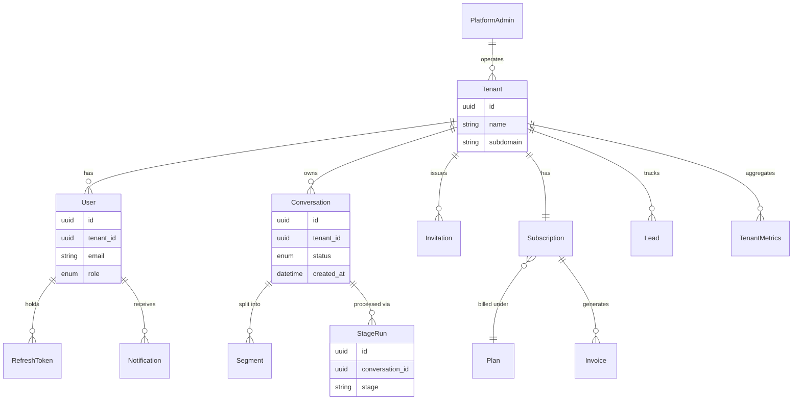

# Master Document 18 — Database Design & Governance

**Controls covered:** P5-01 (ERD and normalized schema documented), P5-02 (Indexing, partitioning and performance design documented), P5-03 (Backup, restore, retention and archiving strategy defined), P5-04 (Audit trail at data layer), P5-05 (Master data, reference data and metadata governed), P6A-06 (Database engineering specification — same evidence as P5-01/P5-02, viewed from the P6A engineering-spec angle), P22-01 (Data classification), P22-02 (Retention enforcement), P22-03 (Consent management and DSAR)
**Phase:** 5 — Database Engineering
**Status:** Draft — schema evidenced from models/migrations; several controls are real gaps

## P5-01 — ERD and normalized schema
**Status: Partial.** No ERD exists inside `backend/`, but a formal ERD exists in the separate `AI-Conversation-Intelligence-Architecture/` project (`source/mermaid/03_Data_Architecture/33_Analytics_ERD.mmd`, with rendered `.png`/`.md`), plus `docs/database/overview.md` and `docs/diagrams/03_Data_Architecture/40_Data_Lifecycle.md` in that sub-project. **This ERD has not been confirmed to match the actual `backend/app/models/__init__.py` schema** — it may describe the target architecture rather than current tables.

Current schema (evidenced, `app/models/__init__.py`, 9 sequential Alembic migrations `0001`–`0009`): `Tenant`, `User`, `Invitation`, `Conversation`, `Segment`, `StageRun`, `Notification`, `TenantMetrics`, `Plan`, `Subscription`, `Lead`, `Invoice`, `RefreshToken`, `PlatformAdmin`, plus enums (`Role`, `ConversationStatus`, `InvitationStatus`, `NotificationKind`, `SubscriptionStatus`, `InvoiceStatus`).

**Interim hand-drafted ERD** (core entities and relationships, transcribed from the model list below — supersedes "no ERD exists" but is explicitly **not** a substitute for the code-generated ERD in the recommendation that follows; hand-transcription can drift from the live schema in ways a generated diagram cannot):

**Recommendation (spec)**: generate the ERD directly from `backend/app/models/__init__.py` via `eralchemy2` or `sqlalchemy-schemadisplay` (either reads SQLAlchemy metadata directly, avoiding a hand-drawn diagram that drifts from the schema), commit the rendered `.svg`/`.png` to `docs/04-DATABASE/`, and regenerate it as a CI check whenever a migration is added (`migration-check.yml` already runs on every PR — extend it to also regenerate/diff the ERD). Reconcile once against the architecture-repo's ERD and note divergences explicitly in this document; do not attempt to keep the two in permanent lockstep — the architecture-repo's ERD is a target-state reference, not a second source of truth for the current schema.

## P5-02 — Indexing, partitioning, performance design
**Status: Partial implementation, rationale and trigger now documented.** 26 instances of `Index(`/`index=True`/`unique=True`/`UniqueConstraint` found across models — e.g. `Tenant.name`/`subdomain` unique constraints; `Notification.created_at` and `Lead.created_at` indexed.

**Indexing rationale (by table):**
| Table | Index | Why |
|---|---|---|
| `Tenant` | unique(`name`), unique(`subdomain`) | Subdomain resolution is a hot lookup on every request (`tenant_resolution.py`); must be unique and fast |
| `Conversation` | index(`tenant_id`, `created_at`) *(add if missing)* | Every analytics query filters by tenant and sorts/filters by time range — this is the highest-traffic query pattern in the system |
| `Segment` | index(`conversation_id`) | Segments are always fetched by parent conversation |
| `StageRun` | index(`conversation_id`, `stage`) | Pipeline status/audit queries filter by conversation and stage |
| `Notification` | index(`created_at`), index(`tenant_id`, `read`) *(add if missing)* | Notification feeds are queried by recency and unread-status per tenant |
| `RefreshToken` | index(`family_id`), index(`jti`) | Reuse-detection lookup must be O(1) on every refresh call |
| `Lead` | index(`created_at`) | Lead-list views sort by recency |

**Partitioning policy**: **not needed yet — explicit decision, not an oversight.** Trigger to revisit: partition `Conversation`/`Segment` (the two tables expected to grow unbounded with usage) by `tenant_id` range or `created_at` range (monthly) once either table exceeds **10 million rows** or query p95 latency on tenant-scoped conversation lists exceeds 500ms — whichever comes first. This threshold should be added as a Prometheus alert once the table-size metric is instrumented, so the trigger is monitored rather than manually checked.

## P5-03 — Backup, restore, retention, archiving strategy
**Status: Target defined by founder (intake form Q26), not yet implemented.** No backup/restore scripts found in `backend/`. Mentions of "backup/restore/retention/archive" exist only in the architecture-docs tree (`AI-Conversation-Intelligence-Architecture/docs/diagrams/.../40_Data_Lifecycle.md`) — these are design references, not implemented operational procedures.

**Founder-supplied target**: daily automated backups, with 30 days of backup retention planned for production, to be finalized and implemented before production launch. This gives engineering a concrete number to build against — it does not itself close the gap, since no implementation exists yet.

**Conversation-data retention/deletion (resolved, intake form Round 2 Q35)**: production conversation data itself is retained **30 days**, separately from the 30-day *backup* retention above — these are two different 30-day windows that happen to share a number and must not be conflated in implementation (a backup taken on day 29 of a conversation's life still needs its own 30-day backup-retention clock, independent of the source record's deletion). Deletion is triggered by a support request, processed and recorded by the system; self-service deletion is deferred. **Open question flagged in Master Document 11**: whether 30-day raw-conversation retention is compatible with longer-horizon analytics trends the product implies — needs founder confirmation that aggregated scores/metrics are retained on a separate, longer schedule from raw content.

**Recommendation**: this is a genuine operational gap, not just a documentation gap — production deployment without a confirmed backup/restore procedure is a real risk. Implement: (1) daily backups with 30-day backup retention, (2) a scheduled deletion job enforcing the 30-day conversation-data retention window (ties to Master Document 24's scheduled-jobs spec — this is a third Celery Beat job alongside refresh-token and stale-`StageRun` cleanup), (3) a restore-test procedure before handling real customer data at scale.

## P5-04 — Audit trail at data layer
**Status: Spec defined, not yet implemented.** No dedicated audit-log table or generic audit-trail mechanism found in `backend/app/`. Per-model `created_at`/`updated_at` timestamps exist (e.g. `Conversation`, `TenantMetrics`) but these are basic bookkeeping fields, not an audit trail (they don't record *who* changed *what* and *when* for mutable records like role changes, billing changes, or tenant settings).

**Specification:**
1. **Single generic `AuditLog` table** (not per-table audit tables — one schema is easier to query and maintain): `{id, tenant_id (nullable, null = platform-level), actor_type ("user"|"platform_admin"|"system"), actor_id, action (e.g. "role.changed", "subscription.updated", "tenant.suspended"), entity_type, entity_id, before (JSON, nullable), after (JSON), created_at}`.
2. **Tables in scope** (mutable, consequential records): `User.role` changes, `Subscription`/`Invoice` state transitions, `PlatformAdmin` actions on tenants (suspend/reactivate/impersonate-adjacent actions), `Plan` catalog edits (ties to P5-05 below), and — once built — the AI-finding review-status workflow (Master Document 16, P7-05).
3. **Write path**: a single `record_audit()` helper called explicitly at each mutation site (not a blanket ORM hook/trigger, which tends to capture noise and miss business-meaning) — keeps the audit log intentional: it records *decisions*, not every column touch.
4. **Read path**: exposed only via platform-admin endpoints (`/platform/audit`), scoped by tenant for tenant-initiated support investigations, never exposed to tenant end-users directly (an audit log of "who changed your role" could itself leak role-management details you don't want visible).
5. This table also backs Master Document 16's P7-04 conceptually (both are "record what happened, who did it, when") but pipeline-stage AI audit stays on the extended `StageRun` (higher volume, different query pattern) rather than being forced into this general-purpose table.

## P5-05 — Master data, reference data, metadata governance
**Status: Governance process now specified.** `Plan` catalog data is seeded directly in migration `0005_billing.py` (`plans_table.insert().values(...)`) — this is reference/master data with direct revenue impact.

**Specification**: `Plan` catalog changes (new tier, price change, credit-allotment change) require: (1) a dedicated migration — never an ad-hoc data patch — so every pricing change is version-controlled and reviewable as a diff; (2) sign-off from the Billing row owner (per Master Document 26 RACI: Huzayfa Talha, Responsible; Nasib Khan, Accountable) in addition to the standard engineering code-review, since this is a revenue decision, not just a schema change; (3) the change is logged in the P5-04 `AuditLog` table (`action="plan.changed"`) so historical pricing is reconstructable for billing-dispute resolution.

## P22-01 — Data classification policy
**Status: Spec defined, not yet implemented.** No formal data-classification labeling exists in the schema today.

**Specification:**
| Class | Examples | Handling |
|---|---|---|
| Restricted (PII/customer content) | `Conversation`/`Segment` raw content and transcripts, redacted-PII spans, `raw_output_ref` LLM outputs | Tenant-scoped access only; subject to the P22-02 retention window; PII-redaction pre-pass (Master Doc 16 P7-02 §2) before third-party (Anthropic) transmission |
| Confidential (business data) | `Invoice`, `Subscription`, `Plan`, billing records | Tenant-scoped; audit-logged on change (P5-04) |
| Internal (operational) | `StageRun`, `Notification`, metrics | Platform-admin and tenant-scoped as appropriate; not customer-secret but not public |
| Public | None currently — no publicly-exposed content model exists | N/A |

**Stewardship**: data classification is a joint responsibility of the Database owner (Huzayfa Talha, implementation) and the Security owner (Farhan Sadik, policy) per Master Document 26 RACI; new tables/columns must be classified at design time (added to the PR checklist in `.github/PULL_REQUEST_TEMPLATE.md`), not retrofitted.

## P22-02 — Retention enforcement
**Status: Spec defined, extends the P5-03 target into an executable design.** The 30-day conversation-data retention target (P5-03, Round 2 Q35) currently has no enforcement mechanism in code.

**Specification**: a third scheduled Celery Beat job (alongside the refresh-token cleanup and stale-`StageRun` jobs specified in Master Document 24) — `enforce_conversation_retention`, running daily, that: (1) identifies `Conversation` records past the 30-day retention window, (2) hard-deletes raw content and associated `Segment`/media/S3 objects, (3) retains aggregated analytics/scores per the open question flagged in Master Document 11 (pending founder confirmation on whether aggregates outlive raw content), (4) writes a `retention.purged` row to the P5-04 `AuditLog` (count + tenant, not per-record detail, to avoid the audit log itself becoming a PII store) so purge activity is itself auditable. Backup-retention (a separate 30-day clock, per P5-03) is unaffected — a purged production record's prior backups still age out on their own schedule.

## P22-03 — Consent management and DSAR (Data Subject Access Request) workflow
**Status: Spec defined, not yet implemented.** No consent-tracking or DSAR-handling mechanism exists.

**Specification:**
1. **Consent**: tenant-level agreement to Sonic's Terms of Service / DPA (see `docs/12-LEGAL/`) captured at signup (`Tenant.tos_accepted_at`, `Tenant.dpa_accepted_at` — new columns); end-user-level consent (e.g. a contact-center agent whose calls are recorded) is the tenant customer's own responsibility as data controller, with Sonic acting as processor — this boundary must be stated explicitly in the DPA, not assumed.
2. **DSAR intake**: per the current support-driven model (P5-03, deletion triggered by support request, self-service deferred), a DSAR (access or deletion request) is logged as a support ticket, actioned manually by the platform-admin team via existing `/platform` tooling, and recorded in the `AuditLog` (`action="dsar.fulfilled"`). Self-service DSAR tooling is a post-GA enhancement, not a launch blocker, given current customer scale.
3. **Response SLA**: 30 days (aligned with common data-protection regulatory norms — e.g. GDPR Art. 12(3) — as a proportionate proxy standard even though Sonic's initial markets are Bangladesh/Nepal, per Master Document 6 §regulatory note and the Round 2 regulatory-assessment gap tracked in this document set).

## Outcome
- [x] ERD generation approach specified (`eralchemy2` from live models, CI-regenerated) — generation itself still an implementation task
- [x] Interim hand-drafted ERD (core entities/relationships) added directly to this document, closing the "no ERD exists" gap while the code-generated version remains outstanding — explicitly flagged as lower-confidence than a generated diagram
- [x] Backup/restore/retention **target** defined by founder (daily backups, 30-day retention — Q26); implementation before production customer data is handled at scale remains the highest-priority open item in this document
- [x] Audit-trail schema and scope fully specified for role/billing/platform-admin-action tables (P5-04) — implementation outstanding
- [x] Indexing rationale documented and partitioning trigger threshold set (P5-02) — implementation of any missing indexes outstanding
- [x] Plan-catalog change-governance process specified (P5-05)
- [x] Data classification policy specified (P22-01) — retroactive per-table classification and PR-checklist enforcement still outstanding
- [x] Retention-enforcement job specified as a third Celery Beat job, extending Master Document 24 (P22-02) — implementation outstanding
- [x] Consent capture and DSAR workflow specified, tied to `docs/12-LEGAL/` (P22-03) — implementation and self-service tooling outstanding
