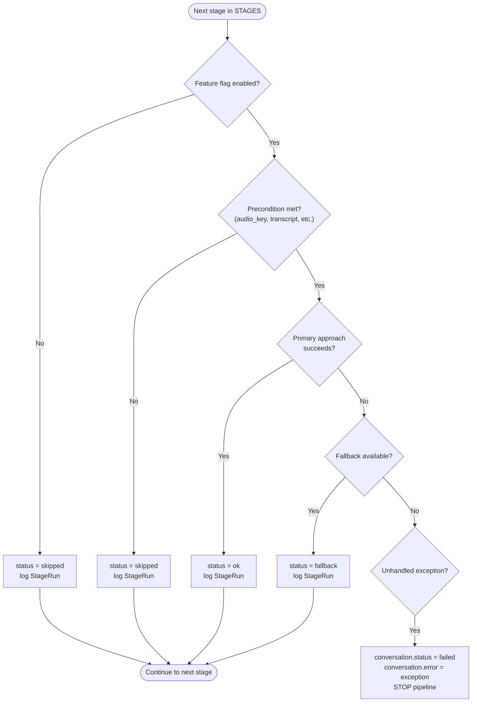

# Automation / Workflow Engine Design (Phase P26)

Sonic's automation engine is the AI pipeline runner (`app/pipeline/runner.py` + `stages.py`) plus a rule-triggered notification layer. There is no separate low-code workflow builder — automation is implemented as a fixed, ordered pipeline of stages, each with explicit if/then trigger logic for side effects (notifications), and every stage execution is logged for audit.

---

## 1. Pipeline Trigger

```
IF   a user uploads audio (POST /conversations)
THEN create Conversation(status=uploaded)
 AND store raw audio to object storage
 AND dispatch_pipeline(conversation_id) → Celery task queued
```

If dispatch to the queue itself fails, the conversation is immediately marked `failed` with an error message — no silent drops.

## 2. Pipeline Stage Execution Rules

Each of the 10 stages runs in fixed order for every conversation: `audio → asr → diarization → emotion → nlp → llm → qa → prediction → analytics → indexing`.

```
FOR each stage IN STAGES:
  IF   stage feature flag (SONIC_ENABLE_<STAGE>) is false
  THEN status = "skipped", log StageRun, continue to next stage

  ELSE IF required precondition missing (e.g. no audio_key, empty transcript)
  THEN status = "skipped", log StageRun, continue to next stage

  ELSE IF primary approach succeeds
  THEN status = "ok", log StageRun, continue

  ELSE IF primary approach fails/unavailable AND a fallback exists
  THEN status = "fallback", log StageRun, continue

  ELSE IF stage raises an unhandled exception
  THEN conversation.status = "failed", conversation.error = <exception>, STOP pipeline
```

Stages are documented as **idempotent** — safe to re-run — and designed to complete even with no GPU, no ffmpeg, and no API keys present (every heavy dependency is lazily imported and guarded).



## 3. Business Rule Triggers (If/Then Automation)

These are the automation rules that produce a visible business action (a `Notification` row) rather than just pipeline data:

| Trigger condition | Action | Stage |
|---|---|---|
| QA rule evaluation returns `passed: false` | Create `Notification(kind=error, title="Compliance violation", body="<conversation title>: failed <rule names>")` | `stage_qa` |
| `prediction.churn_risk >= 0.7` | Create `Notification(kind=warning, title="Churn risk spike", body="<title> scored <N>% churn risk")` | `stage_prediction` |
| `prediction.escalation_risk >= 0.7` | Create `Notification(kind=warning, title="Escalation risk", body="<title> scored <N>% escalation risk")` | `stage_prediction` |
| QA score < 0.5 | Escalation risk heuristic score boosted +0.2 (feeds the escalation-risk rule above) | `_heuristic_predict` |
| Transcript contains any of `cancel`/`refund`/`billing`/`price`/`help`/`complaint`/`upgrade` | Segment tagged with corresponding `intent` | `stage_nlp` |
| Transcript keyword match against `RISK_KEYWORDS` (billing, cancellation, escalation, negative sentiment terms) | Surfaced as a risk category count on the Analytics → Risks dashboard | `analytics.risks` endpoint (query-time, not stored) |

All notification rules are currently hard-coded thresholds in `stages.py` (0.7 for risk scores, boolean QA pass/fail) — there is no tenant-configurable rule builder for notification triggers yet (QA *rules themselves* are tenant-configurable via YAML; the notification *thresholds* on prediction scores are not).

## 4. QA Rule Engine (Tenant-Configurable Automation)

Unlike the fixed pipeline stages, QA rules are data-driven and tenant-overridable:

- Default rules: `backend/rules/qa_rules.yaml`.
- Per-tenant override: `Tenant.qa_rules_path`, falling back to global `SONIC_QA_RULES_PATH`.
- Evaluated by `app/services/qa_rules.py` (`load_rules` + `evaluate`) against the call transcript, producing pass/fail findings per rule.
- Optionally refined by an LLM-as-judge pass (best-effort; silently skipped if the LLM provider is unreachable) — result `source` field records whether the judge ran (`"rules_engine"` vs `"rules_engine+llm_judge"`), so the audit trail always shows which evaluation path actually produced a given QA result.

## 5. Audit Trail — What Gets Logged When an Automated Action Fires

**`StageRun` table** — one row per stage per conversation, recording:
- `stage` (name), `status` (`ok`/`fallback`/`skipped`/`failed`), `detail` (human-readable reason, e.g. `"ffmpeg not available; using original audio"`), `duration_ms`, `started_at`.
- This gives a complete, queryable timeline of exactly what ran (and whether it used the real model or a fallback) for every conversation — surfaced via `GET /conversations/{id}` (`stage_runs[]`) and `GET /health/pipeline`.

**`Notification` table** — one row per triggered business rule, recording:
- `kind` (error/warning/info/success), `title`, `body` (includes the conversation title and the specific triggering value, e.g. "scored 82% churn risk"), `conversation_id` (traceable back to the source event), `created_at`, `read` status.
- This is the audit trail for *automated actions with business visibility* — every compliance violation, churn-risk spike, and escalation-risk spike is permanently recorded, not just transiently displayed.

**Conversation-level audit fields:**
- `status`, `current_stage`, `error` — track pipeline progress/failure state directly on the conversation record.
- `updated_at` — auto-updates on every write, giving a coarse last-modified timestamp.

### Audit Trail Gaps

- No append-only/immutable audit log exists for **user actions** (login, settings changes, role changes, tenant admin actions) — only AI-pipeline and notification events are logged today. See [Security Architecture Document](08-security-architecture.md) §3 for the recommended audit log specification to close this gap.
- Notification threshold values (0.7 risk cutoff) are not themselves versioned/audited if changed in code — they are not tenant-configurable data, so any change ships as a code deploy, which is tracked via normal git history rather than a runtime audit log.
